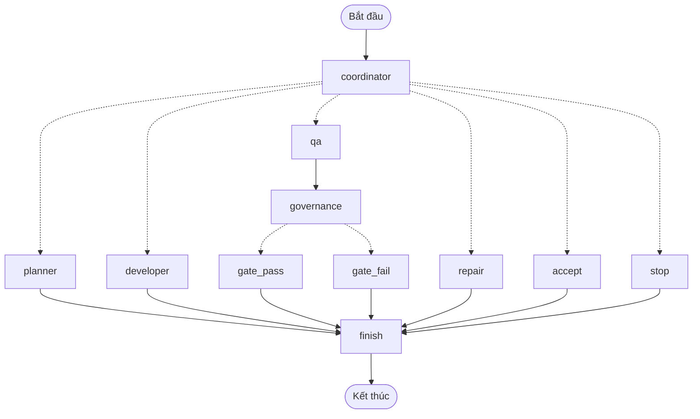

# BÁO CÁO KỸ THUẬT VÀ GIẢI THÍCH CHI TIẾT MÃ NGUỒN HỆ THỐNG HUB-AND-SPOKE

> **Chuyên đề Kỹ thuật Phần mềm (KTPM)**  
> **Chủ đề:** Mô hình Kiến trúc Điều phối Đa Tác tử (Multi-Agent Orchestration) với LangGraph và Kiểm soát An toàn (Governance & Policy Gate)  
> **Mã nguồn hệ thống:** `Bo-thuyet-trinh/02-Agentic-PM/hub-and-spoke/`  
> **Giao diện Demo:** `http://127.0.0.1:8767/hub`

---

## MỤC LỤC
1. [TỔNG QUAN HỆ THỐNG VÀ BÀI TOÁN KỸ THUẬT](#1-tổng-quan-hệ-thống-và-bài-toán-kỹ-thuật)
2. [SỰ THẬT VỀ GRAPH VÀ TỆP WORKFLOW.MMD](#2-sự-thật-về-graph-và-tệp-workflowmmd)
3. [KIẾN TRÚC TỔNG THỂ VÀ LUỒNG DỮ LIỆU](#3-kiến-trúc-tổng-thể-và-luồng-dữ-liệu)
4. [BÁO CÁO CHI TIẾT TỪNG MODULE VÀ TỆP TIN](#4-báo-cáo-chi-tiết-từng-module-và-tệp-tin)
   - [4.1. Module Điều phối Cốt lõi: workflow.py](#41-module-điều-phối-cốt-lõi-workflowpy)
   - [4.2. Module Web Server & REST API: app.py](#42-module-web-server--rest-api-apppy)
   - [4.3. Module Quản trị An toàn (Policy Gate): governance.py](#43-module-quản-trị-an-toàn-policy-gate-governancepy)
   - [4.4. Module Quản lý Luồng & Prompt: pipeline.py](#44-module-quản-lý-luồng--prompt-pipelinepy)
   - [4.5. Module Giao tiếp LLM: llm.py](#45-module-giao-tiếp-llm-llmpy)
   - [4.6. Module Worker Kiểm thử Độc lập: qa_worker.py](#46-module-worker-kiểm-thử-độc-lập-qa_workerpy)
   - [4.7. Module Lưu trữ Bền vững: store.py](#47-module-lưu-trữ-bền-vững-storepy)
   - [4.8. Cấu hình Môi trường: config.py & .env](#48-cấu-hình-môi-trường-configpy--env)
   - [4.9. Giao diện Web Client: thư mục web/](#49-giao-diện-web-client-thư-mục-web)
5. [QUY TRÌNH VẬN HÀNH VÀ KỊCH BẢN THỬ NGHIỆM](#5-quy-trình-vận-hành-và-kịch-bản-thử-nghiệm)
6. [ĐÁNH GIÁ VÀ KẾT LUẬN](#6-đánh-giá-và-kết-luận)

---

## 1. TỔNG QUAN HỆ THỐNG VÀ BÀI TOÁN KỸ THUẬT

### 1.1. Bối cảnh
Trong kỹ thuật phần mềm hiện đại, việc sử dụng các mô hình ngôn ngữ lớn (LLMs) để tự động sinh mã nguồn (Code Generation) thường đối mặt với các rủi ro:
1. **Ảo giác (Hallucination):** LLM sinh mã sai logic, không đáp ứng đủ yêu cầu nghiệp vụ.
2. **Lỗ hổng bảo mật (Security Risks):** LLM vô tình viết cứng các secret (API key, database password), hoặc gọi các hàm nguy hiểm gây thực thi mã tùy ý (`eval`, `exec`, `os.system`).
3. **Mất kiểm soát luồng (Agentic Drift):** Khi trao quyền quá lớn cho AI tự quyết định (Autonomous Agent), hệ thống có thể lặp vô tận hoặc đưa ra quyết định sai mà con người không kịp can thiệp.

### 1.2. Giải pháp Kiến trúc: Hub-and-Spoke với LangGraph
Hệ thống demo này áp dụng mô hình kiến trúc **Hub-and-Spoke** (Trục bánh xe và các nan hoa):
- **Hub trung tâm (Coordinator):** Đóng vai trò là "Bộ điều phối duy nhất". Mọi tương tác, chuyển giao dữ liệu giữa các Agent đều bắt buộc phải đi qua Hub. Các Spoke agent không được gọi chéo trực tiếp lẫn nhau.
- **Các Spoke chuyên biệt:** Mỗi Spoke chịu trách nhiệm cho một tác vụ hẹp duy nhất (Planner lên kế hoạch, Developer viết mã, QA kiểm thử, Governance kiểm tra chính sách bảo mật).
- **Cơ chế Human-in-the-loop (HITL):** Thay vì để AI tự động chạy từ đầu đến cuối rồi commit lên hệ thống, hệ thống dừng lại ở từng bước để người dùng quan sát và bắt buộc con người phải bấm "Chấp nhận kết quả" (Review & Accept).

---

## 2. SỰ THẬT VỀ GRAPH VÀ TỆP WORKFLOW.MMD

### 2.1. Tệp `WORKFLOW.mmd` là gì?
- `.mmd` là viết tắt của **Mermaid Diagram** – định dạng biểu diễn lưu đồ (flowchart) bằng văn bản plain-text.
- Tệp này **được sinh ra tự động** từ script `export_graph.py` thông qua lời gọi:
  ```python
  build_graph(None).get_graph().draw_mermaid()
  ```
  Nó trích xuất chính xác cấu trúc đồ thị điều phối **LangGraph** (`StateGraph`) đang chạy ở backend.

### 2.2. Tại sao trên Web Demo (`http://127.0.0.1:8767/hub`) không thấy Graph?
Nhiều người khi chạy demo thắc mắc tại sao không thấy giao diện vẽ mạng lưới sơ đồ các node di chuyển. Lý do:
1. **Khái niệm "Graph" ở đây là kiến trúc Backend:** Graph là cấu trúc điều khiển trạng thái ngầm được xây dựng bằng thư viện `langgraph.graph.StateGraph`. Nó quản lý logic rẽ nhánh, điểm bắt đầu (`START`), điểm kết thúc (`END`), và các cạnh điều kiện (`conditional edges`).
2. **Mục đích của `WORKFLOW.mmd`:** Tệp này dùng để **làm báo cáo đồ án, đưa vào tài liệu kỹ thuật hoặc làm slide thuyết trình bảo vệ chuyên đề**. Người đánh giá có thể mở file này bằng Mermaid Preview để kiểm chứng logic thiết kế của nhóm.
3. **Trên Web UI thể hiện Graph như thế nào?** Giao diện web được tối ưu hóa cho trải nghiệm người dùng thực tế: thay vì vẽ đồ thị phức tạp, nó hiển thị **Tiến trình từng bước (Step-by-step Execution)** và **Nhật ký xử lý (Event History)** theo đúng thứ tự các node mà đồ thị LangGraph đã ghé qua.

### 2.3. Cấu trúc đồ thị thực tế trong hệ thống:


---

## 3. KIẾN TRÚC TỔNG THỂ VÀ LUỒNG DỮ LIỆU

Hệ thống hoạt động theo mô hình 4 tầng phân tách rõ ràng:

1. **Presentation Layer (Tầng hiển thị):**
   - Web Client thuần HTML/JS/CSS tại thư mục `web/`.
   - Kết nối với Backend qua HTTP REST API với cơ chế chống CSRF bằng token ứng dụng (`X-App-Token`).
2. **API & Orchestration Gateway Layer (Tầng máy chủ API):**
   - `app.py`: Server HTTP chạy cổng `8767`.
   - Sử dụng cơ chế khóa phân tán cục bộ (`Threading Lock`) để đảm bảo các yêu cầu được tuần tự hóa, tránh xung đột trạng thái (race conditions).
3. **State Engine Layer (Tầng máy trạng thái LangGraph):**
   - `workflow.py`: Quản lý `RunState` và các Node của LangGraph.
   - `pipeline.py`: Chịu trách nhiệm khởi tạo trạng thái và định dạng prompt.
4. **Agent Execution & Security Guard Layer (Tầng tác tử & rào chắn bảo mật):**
   - `governance.py`: Bộ phân tích tĩnh AST kiểm tra chính sách bảo mật.
   - `qa_worker.py`: Bộ kiểm thử chức năng chạy trong sub-process độc lập, không dùng `exec()`.
   - `llm.py`: Cổng giao tiếp với Gemini API kèm kiểm soát giới hạn gọi (rate limit).

---

## 4. BÁO CÁO CHI TIẾT TỪNG MODULE VÀ TỆP TIN

### 4.1. Module Điều phối Cốt lõi: `workflow.py`
Tệp này là trái tim của kiến trúc Hub-and-Spoke, hiện thực hóa đồ thị LangGraph.

- **Định nghĩa kiểu dữ liệu `RunState`:**
  ```python
  class RunState(TypedDict):
      session: dict       # Toàn bộ dữ liệu nghiệp vụ của phiên (lưu trong SQLite)
      confirmed: bool     # Cờ đánh dấu người dùng đã duyệt
      route: str          # Nhãn của node kế tiếp do Hub chọn
      visited: list[str]  # Danh sách lịch sử các node đã thực thi
  ```
- **Node Hub Trung tâm (`coordinator`):**
  - Đóng vai trò là Router thông minh. Dựa vào `phase` của phiên để quyết định Spoke:
    - `ready` -> điều hướng sang `planner`.
    - `planned` -> điều hướng sang `developer`.
    - `coded` -> điều hướng sang `qa`.
    - `blocked` -> kiểm tra nếu đã sửa quá 3 lần (`repairs >= 3`) thì chuyển sang `stop`; nếu chưa thì chuyển sang `repair`.
    - `review` -> chuyển sang `accept` khi người dùng bấm xác nhận.
- **Các Spoke Nodes:**
  - `planner`: Gọi LLM sinh User Story gồm `title` và danh sách `acceptance` criteria.
  - `developer`: Gọi LLM sinh mã Python hoặc nhận mã nguồn sẵn có từ người dùng.
  - `qa_node`: Chạy bộ test AST trên worker riêng.
  - `governance`: Chạy bộ quét tĩnh AST phát hiện vi phạm.
  - `gate_route`: Đưa ra phán quyết bằng code Python thuần:
    ```python
    return "gate_pass" if s["qa"]["pass"] and s["governance"]["pass"] else "gate_fail"
    ```
    *Điểm nhấn quan trọng:* LLM **không có quyền tự tuyên bố PASS**. Việc phán quyết hoàn toàn do code kiểm soát logic bảo mật của hệ thống quyết định.
  - `repair`: Che giấu secret bị lộ (`redact_code`) và gửi lỗi về cho Developer Spoke để viết lại mã nguồn.
  - `finish`: Cập nhật phiên bản (`version += 1`), chuẩn bị dữ liệu phản hồi cho Web.

---

### 4.2. Module Web Server & REST API: `app.py`
Xây dựng máy chủ HTTP Threading độc lập, bảo mật cao:
- **Tiêu chuẩn An ninh Web:**
  - Chỉ phục vụ trên địa chỉ `127.0.0.1` hoặc `localhost` (chặn toàn bộ truy cập từ mạng ngoài).
  - Tích hợp tiêu chuẩn Content Security Policy (CSP), chặn `iframe` (chống Clickjacking với `X-Frame-Options: DENY`), chống đánh cắp MIME type (`nosniff`).
  - Sử dụng Token phiên ứng dụng (`X-App-Token`) để xác thực mọi request POST.
- **Các API chính:**
  - `GET /api/config`: Trả về thông số model và trạng thái đã cấu hình API key hay chưa.
  - `POST /api/sessions`: Khởi tạo một phiên làm việc mới khi người dùng gửi prompt.
  - `POST /api/next`: Điểm kích hoạt bước tiếp theo của đồ thị. Sử dụng cơ chế `lock(sid)` để nếu người dùng nhấn nút nhiều lần liên tiếp, hệ thống sẽ trả về mã `409 Conflict` thay vì làm lỗi dữ liệu.

---

### 4.3. Module Quản trị An toàn (Policy Gate): `governance.py`
Module này giải quyết bài toán cốt lõi trong an toàn phần mềm sinh bởi AI:

- **Phân tích AST không thực thi (Non-executing AST Inspection):**
  - Hệ thống sử dụng thư viện chuẩn `ast` của Python để phân tích cú pháp mã nguồn thành cây đối tượng.
  - Tuyệt đối không dùng `exec()` hoặc `eval()` để chạy mã của LLM trên máy chủ.
- **Các Quy tắc Kiểm tra An toàn:**
  1. `HARDCODED_SECRET`: Bắt các biến có tên như `secret`, `token`, `api_key`, `password` mà được gán chuỗi trực tiếp. Buộc phải dùng `os.getenv`.
  2. `UNSAFE_CALL`: Cấm triệt để việc gọi các hàm `eval`, `exec`, `open`, `__import__`, `getattr`, `setattr`, `globals`, `locals`, `vars`, `input`.
  3. `IMPORT`: Giới hạn nghiêm ngặt thư viện import, chỉ cho phép `re` và `os.getenv`.
  4. `INTERFACE`: Bắt buộc mã sinh ra phải tuân thủ đúng một hàm giao diện duy nhất: `validate_email(email)`.
- **Cơ chế Redaction (`redact_code`):**
  - Khi phát hiện mã có secret viết cứng, trước khi gửi lại cho LLM sửa, hệ thống sẽ tự động bọc chuỗi đó lại thành `"REDACTED"`, tránh việc secret tiếp tục bị gửi lên server đám mây.

---

### 4.4. Module Quản lý Luồng & Prompt: `pipeline.py`
- Định nghĩa các **System Prompt** được tinh chỉnh kỹ lưỡng:
  - Bắt buộc LLM phải trả về định dạng JSON thuần túy (không bọc trong markdown code fence).
  - Không cho phép LLM tự bịa kết quả kiểm thử.
- Khởi tạo đối tượng `Session State` với các trường dữ liệu theo dõi toàn diện: `phase`, `status`, `story`, `code`, `qa`, `governance`, `repairs`, `events`, `calls`.
- Cung cấp hàm cầu nối `advance(state, model, confirmed)` để chuyển giao dữ liệu từ Web Server vào hàm `run_step` của LangGraph.

---

### 4.5. Module Giao tiếp LLM: `llm.py`
- Kết nối trực tiếp tới Google Generative Language API (`Gemini`) bằng thư viện `urllib.request` thuần, không phụ thuộc thư viện nặng.
- **Kiểm soát Tốc độ (Rate Limiting):** Tích hợp biến khóa `_lock` và thời gian chờ tối thiểu 2 giây giữa hai lời gọi liên tiếp nhằm tránh bị giới hạn băng thông (HTTP 429).
- **Phân tích cú pháp an toàn:** Hàm `parse_object` làm sạch chuỗi và bóc tách dữ liệu JSON nghiêm ngặt.
- Báo cáo chi tiết số lượng Token đầu vào/đầu ra và thời gian phản hồi (Latency) cho từng bước.

---

### 4.6. Module Worker Kiểm thử Độc lập: `qa_worker.py`
- Chạy như một tiến trình con (sub-process) độc lập được gọi từ `governance.py`.
- Thiết lập giới hạn thời gian thực thi (Timeout 4 giây). Nếu mã bị treo hoặc lặp vô tận, tiến trình sẽ tự động bị tiêu hủy và báo `FAIL`.
- Thông dịch mã bằng AST để kiểm tra tính đúng đắn của logic hàm `validate_email` đối với các bộ dữ liệu test case mẫu mà không cần chạy code thô.

---

### 4.7. Module Lưu trữ Bền vững: `store.py`
- Sử dụng cơ sở dữ liệu **SQLite** (`.state/sessions.sqlite3`).
- Đảm bảo tính bền bỉ của dữ liệu (Persistence): Nếu máy chủ bị khởi động lại hoặc trình duyệt bị tải lại trang, phiên làm việc trước đó vẫn được khôi phục nguyên vẹn.
- Hỗ trợ cơ chế khóa luồng theo từng phiên (`session lock`) để tránh xung đột dữ liệu đa luồng.

---

### 4.8. Cấu hình Môi trường: `config.py` & `.env`
- Quản lý cấu hình tập trung thông qua tệp `.env`.
- Các tham số chính:
  - `GEMINI_API_KEY`: Khóa API của Google Gemini.
  - `GEMINI_MODEL`: Mô hình AI sử dụng (mặc định: `gemini-1.5-flash`).
  - `PORT`: Cổng mạng chạy dịch vụ (mặc định: `8767`).
  - `TIMEOUT`: Thời gian chờ tối đa cho mỗi lệnh gọi mạng.

---

### 4.9. Giao diện Web Client: thư mục `web/`
- Bao gồm: `hub.html`, `app.js`, `style.css`.
- Được thiết kế trực quan chia làm 2 cột:
  - Cột trái (**Đầu vào**): Nhập yêu cầu, có các nút nhấn nhanh để điền đề bài mẫu hoặc thử nghiệm mã độc/mã có chứa secret giả.
  - Cột phải (**Đầu ra**): Hiển thị tiến trình từng bước, trạng thái phê duyệt của Governance, mã nguồn do Developer sinh ra, và toàn bộ nhật ký sự kiện tương tác giữa các Agent.

---

## 5. QUY TRÌNH VẬN HÀNH VÀ KỊCH BẢN THỬ NGHIỆM

Khi thuyết trình hoặc đánh giá hệ thống, kịch bản chuẩn diễn ra qua 2 tình huống:

### Tình huống 1: Luồng chuẩn (Happy Path)
1. Người dùng bấm **"Điền yêu cầu mẫu"** -> Nhấn **"Chạy yêu cầu"**.
2. **Bước 1 (Planner):** Coordinator gửi yêu cầu cho Planner -> Planner trả về User Story và Acceptance criteria. Trạng thái chuyển thành `planned`.
3. Nhấn **"Chạy tiếp"** -> **Bước 2 (Developer):** Coordinator gửi story cho Developer -> Developer sinh mã Python bản `r1`. Trạng thái chuyển thành `coded`.
4. Nhấn **"Chạy tiếp"** -> **Bước 3 (QA & Governance):**
   - QA chạy các test case kiểm tra hàm `validate_email` -> `PASS`.
   - Governance duyệt AST kiểm tra secret và hàm cấm -> `PASS`.
   - Cổng đánh giá kích hoạt `gate_pass` -> Trạng thái chuyển thành `review`.
5. Người dùng kiểm tra mã nguồn hoàn toàn hợp lệ -> Nhấn nút **"Chấp nhận kết quả"** -> Coordinator xác nhận `accepted` -> Kết thúc thành công.

### Tình huống 2: Thử nghiệm bẫy bảo mật (Security Gate Triggered)
1. Người dùng bấm **"Thử mã có secret giả"** (Mã mẫu chứa: `SECRET_KEY = "sk-123456789"`).
2. Nhấn **"Chạy yêu cầu"** -> Developer bỏ qua bước sinh mới và nạp mã này vào.
3. Khi đến bước Governance:
   - Governance quét cây AST và phát hiện vi phạm `HARDCODED_SECRET` tại dòng khai báo khóa bí mật.
   - Cổng đánh giá kích hoạt `gate_fail` -> Trạng thái bị khóa thành `blocked`.
4. Nhấn **"Chạy tiếp"** -> **Bước Repair (Tự động sửa lỗi):**
   - Hệ thống tự động che khóa bí mật thành `REDACTED`.
   - Coordinator chuyển mã đã che và thông báo lỗi sang Spoke Repair.
   - Developer sửa lại bằng cách sử dụng `os.getenv("SECRET_KEY")`.
   - Phiên bản được nâng lên `r2` và đưa quay trở lại vòng kiểm tra chất lượng từ đầu.

---

## 6. ĐÁNH GIÁ VÀ KẾT LUẬN

### 6.1. Ưu điểm nổi bật của kiến trúc
1. **Tính Kiểm soát và An toàn tuyệt đối:** LLM chỉ đóng vai trò là "công nhân kỹ thuật" (thực hiện công việc viết lách và sinh code). Toàn bộ quyền quyết định, rẽ nhánh luồng và đánh giá an toàn đều thuộc về code Python và bộ phân tích tĩnh AST.
2. **Phân tách trách nhiệm (Separation of Concerns):** Mỗi agent chỉ làm một việc duy nhất với prompt ngắn gọn, giảm thiểu tối đa hiện tượng nhầm lẫn ngữ cảnh của AI.
3. **Minh bạch và có khả năng giải trình (Explainability):** Từng bước di chuyển, từng kết quả test case và quét bảo mật đều được ghi log rõ ràng vào SQLite và hiển thị trực tiếp cho người dùng.

### 6.2. Kết luận
Dự án demo **Hub-and-Spoke với LangGraph** là minh chứng mẫu mực cho việc ứng dụng AI vào quy trình kỹ thuật phần mềm (Software Engineering for AI-driven Systems). Hệ thống giải quyết thành công bài toán cân bằng giữa: **Năng lực tự động hóa của AI** và **Yêu cầu kiểm soát chất lượng, an toàn nghiêm ngặt của kỹ thuật phần mềm truyền thống**.
